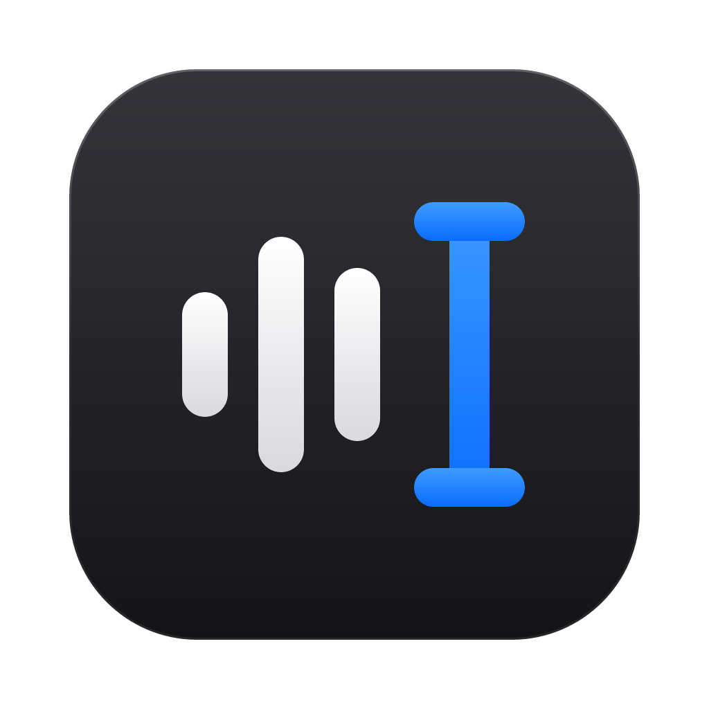
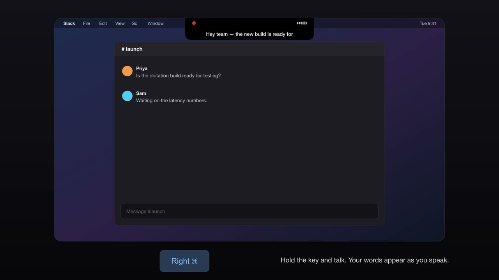

<p align="center">
  
</p>

<h1 align="center">zappp</h1>

<p align="center">
  <b>Hold a key, talk, let go.</b> Your words are typed into whatever app you're using.<br>
  Speech recognition runs on your Mac's Neural Engine — nothing you say is uploaded.
</p>

<p align="center">
  <a href="https://github.com/hiteshbandhu/zappp/releases/latest">Download</a> ·
  <a href="#install">Install</a> ·
  <a href="docs/ARCHITECTURE.md">Architecture</a> ·
  <a href="docs/RELEASING.md">Releasing</a>
</p>

<p align="center">
  <a href="docs/media/zappp-launch.mp4"></a><br>
  <sub>▶ <a href="docs/media/zappp-launch.mp4">Watch the 30-second launch video</a></sub>
</p>

---

## What it does

- **Hold to dictate.** Hold your dictation key (Right ⌘ by default — you can pick fn, Right ⌥ or Right ⌃), speak, release. The text appears where your cursor is, about 100 ms after you let go.
- **See your words as you speak.** A small panel grows out of the camera notch (or the top of the menu bar on Macs without one) and shows a live transcript, a recording dot and a voice meter.
- **Hands-free.** Double-tap the key to keep listening without holding it; tap again to finish. Esc cancels.
- **Command Mode.** Select text, hold Right ⌥ and say how to change it ("make this more formal", "turn this into a bullet list"). Uses Claude with your own API key (Settings → Text).
- **Styles per app.** Verbatim, Clean, Casual or Formal, chosen automatically by app (casual in Slack, formal in Mail).
- **Dictionary.** Teach it names and jargon, and set up replacements ("zap" → "zappp").
- **History.** Everything you dictated, searchable, with copy and delete (with Undo).
- **Menu bar.** Start dictation, paste or copy your last transcript, switch microphone or model, all from the menu bar icon.

## Speech models

All models run locally. Download, switch and delete them in **Settings → Speech Model**.

| Model | Size | Languages | Runs on | Notes |
|---|---|---|---|---|
| **Parakeet v3** (default) | 461 MB | 25 European languages | Neural Engine | Fastest: ~100× real time on an M2 |
| Parakeet v2 | 464 MB | English | Neural Engine | Strongest English accuracy of the Parakeets |
| Bark 3.0 | 205 MB | English | Neural Engine | Compressed Parakeet by Conway Research; ~60× real time |
| Bark 3.0 Plus | 206 MB | English | Neural Engine | Bark tuned for accuracy |
| Parakeet v3 (CPU) | 640 MB | 25 languages | CPU | int8 ONNX; for when the Neural Engine is busy |
| Moonshine Base | 58 MB | English | CPU | Smallest download |

The first time a Neural Engine model loads, macOS spends a minute or two optimizing it for your chip. After that it loads in under a second.

## Install

Requires a Mac with **Apple Silicon** (M1 or later) and **macOS 14 Sonoma** or later.

### Homebrew (recommended)

```bash
brew install --cask hiteshbandhu/tap/zappp
```

### Download

1. Download `zappp-<version>.dmg` from the [latest release](https://github.com/hiteshbandhu/zappp/releases/latest).
2. Open it and drag **zappp** to **Applications**.
3. The first time, **right-click zappp → Open → Open**. (zappp isn't notarized by Apple yet, so macOS asks once.)

### First run

zappp opens a short welcome guide:

1. **Allow three permissions** — Microphone (to hear you), Input Monitoring (to notice your dictation key) and Accessibility (to type the text). Each row turns green the moment you allow it.
2. **Download a speech model** (Parakeet v3 by default).
3. **Try it** in the test field.

After that zappp lives in the menu bar.

> [!NOTE]
> Releases are signed ad-hoc (there is no paid Apple Developer ID yet), so after **updating** zappp macOS may ask for Input Monitoring and Accessibility again. If the switches look on but zappp says they're off, remove zappp from both lists with **−** and allow it again from **Settings → Permissions**.

## Privacy

- Audio never leaves your Mac. Speech recognition runs on-device.
- The only network requests are model downloads (from Hugging Face and the Handy model mirror) — and, **only if you turn it on**, the optional *Claude* clean-up, which sends the transcript text (not audio) to Anthropic's API with your own API key.
- Settings and history are plain JSON in `~/Library/Application Support/zappp`. Logs are in `~/Library/Logs/zappp.log`.

## Build from source

```bash
git clone https://github.com/hiteshbandhu/zappp && cd zappp
scripts/make-dev-cert.sh      # once: a local signing identity so permissions survive rebuilds
scripts/bundle.sh --install   # build, sign and install to /Applications
```

Needs Rust (stable, 2024 edition) and the Xcode Command Line Tools. Useful while developing:

```bash
cargo test                                   # unit tests
target/debug/zappp --bench clip.wav          # compare all installed models on a 16 kHz WAV
target/debug/zappp --bench clip.wav bark-3   # …or just one
target/debug/zappp --install parakeet-v2-ane # download a model from the terminal
ZAPPP_DEMO=1 target/zappp.app/Contents/MacOS/zappp   # sample data + simulated dictation (never saved)
cargo run --example launch_video -- dist/zappp-launch.mp4   # re-render the launch video (needs ffmpeg)
```

See [docs/ARCHITECTURE.md](docs/ARCHITECTURE.md) for how the pieces fit together.

## License

zappp is MIT licensed — see [LICENSE](LICENSE). The speech models are downloaded at runtime under their own licenses (mostly CC-BY 4.0); see [THIRD_PARTY_NOTICES.md](THIRD_PARTY_NOTICES.md).
