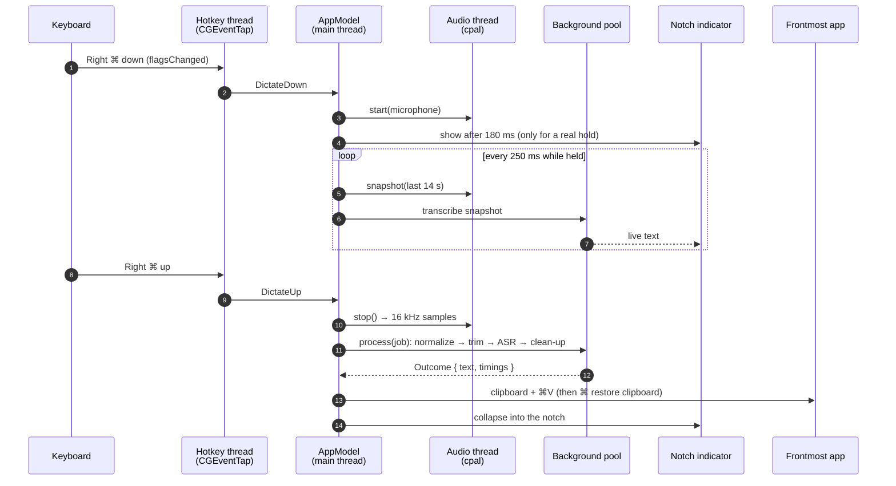

# zappp architecture

zappp is a single native macOS app written in Rust. The UI is
[gpui](https://github.com/zed-industries/zed) (Zed's GPU-rendered UI
framework) with a small component crate, `crates/zui`. Everything that gpui
doesn't cover — global key watching, the menu bar item, the notch overlay,
CoreML, permissions — talks to macOS directly through the `objc2` bindings
and a few C APIs.

```
src/
  main.rs            app startup, windows, menu bar wiring, CLI (--bench, --install)
  app_state.rs       AppModel: settings, history, the dictation state machine
  models.rs          the list of speech models and how to fetch/run each
  store.rs           settings + history JSON in ~/Library/Application Support/zappp
  engine/            everything that isn't UI
    hotkey.rs        CGEventTap thread that watches the dictation keys
    audio.rs         microphone capture (cpal), resampling, silence trim, gain
    asr.rs           runs whichever model is selected
    coreml.rs        thin CoreML wrapper: load/compile models, MLMultiArray I/O
    parakeet_coreml.rs  Parakeet TDT on CoreML (FluidInference's compiled models)
    bark.rs          Underdog Bark 3.0: CoreML encoder + Rust frontend and decoder
    hf.rs            Hugging Face downloads (paths validated)
    cleanup.rs       transcript → final text: fillers, dictionary, styles, Claude
    system.rs        paste/Return keystrokes, frontmost app, AX selection,
                     permissions, notch geometry, Dock visibility
    tray.rs          NSStatusItem menu bar item and its menu
    mod.rs           the dictation pipeline (ASR → clean-up) + native window helpers
  ui/
    mod.rs           main window shell: sidebar, pages, toasts
    home, history, dictionary, modes (Styles), settings, onboarding
    pill.rs          the notch indicator with the live transcript
    toast.rs         copy-button feedback and Undo toasts
crates/zui/          buttons, switches, segmented controls, text input, theme
scripts/             bundle.sh (build + sign + install), make-dev-cert.sh,
                     release.sh (release artifacts + Homebrew cask)
```

## One dictation, end to end



**Threads.** gpui owns the main thread; `AppModel` lives there and is the only
place state changes. The key tap runs its own `CFRunLoop` thread and sends
`HotkeyEvent`s over a channel. cpal's stream isn't `Send`, so it lives on a
dedicated audio thread driven by start/stop commands; a shared buffer lets the
live preview read audio without stopping. ASR and clean-up run on gpui's
background executor. The `Asr` holds the loaded model behind a mutex, so the
live preview and the final pass never run at once.

**The state machine** (`app_state.rs`, `Phase`): `Idle → Recording →
Processing → Done | Error → Idle`.

- A press shorter than 250 ms is a tap, not a dictation. Two taps within
  450 ms start hands-free mode; the next tap finishes it.
- Pressing another key while the dictation key is down (⌘C, ⌘Tab) cancels:
  that's a shortcut, not speech.
- Esc cancels at any time.
- Releasing pastes. Pressing Return afterwards is opt-in ("Press Return After
  Pasting"), or triggered by saying "press enter" at the end.

## Speech recognition

`models.rs` is the registry: each `ModelSpec` names the engine, the source and
the files. Adding a model is adding an entry. Three engines:

### Parakeet on CoreML (`parakeet_coreml.rs`)

FluidInference publishes Parakeet TDT 0.6B already compiled for CoreML as four
models. Per ≤15 s window:

```
Preprocessor (CPU)     audio[240000]       → mel[1,128,1501]
Encoder (Neural Engine) mel                → encoder[1,1024,188]
TDT greedy decode      Decoder (LSTM step) + JointDecision (token, duration)
```

The decoder and joint are tiny and run on the CPU; dispatching them to the
Neural Engine per token is slower. Each window starts with a fresh decoder
state — carrying LSTM state across a cut made the joint emit only blanks.
Long audio is cut at the quietest 20 ms in each window's last 3 seconds.

### Bark 3.0 (`bark.rs`)

Conway Research's Bark is a compressed Parakeet. Its CoreML package contains
only the encoder; the rest is a port of their reference `bark_coreml.py`:

- **Frontend** (Rust): pre-emphasis, centred 512-point STFT (rustfft),
  128 slaney mel bands, log, per-utterance normalization.
- **Encoder** (CoreML, Neural Engine): the `.mlpackage` is compiled once at
  install. It has 8 s and 15 s functions, but only the default (15 s) one gets
  its Neural Engine plan cached by macOS, so every piece runs through the 15 s
  window with a mask.
- **Decoder** (Rust + Accelerate BLAS): 2-layer LSTM and joint head with int8
  weights × per-row fp16 scales, dequantized at load. Greedy TDT decoding.

All weight shapes are validated against each other at load, so corrupt or
hostile files are refused rather than read out of bounds.

### ONNX on the CPU (`asr.rs`)

Parakeet v3 int8 and Moonshine run through
[transcribe-rs](https://crates.io/crates/transcribe-rs) / ONNX Runtime, for
when the Neural Engine is busy or you want a tiny download.

### Neural Engine plans

The first time a CoreML model loads, macOS compiles a Neural Engine plan
(30 s – 3 min) and caches it under `~/Library/Caches/<bundle id>`. Every later
load takes well under a second. zappp warms each model up with a second of
silence after loading so your first dictation doesn't pay for it. The cache
needs free disk space: when the disk is full, loads fail with misleading
CoreML errors ("I/O error", "not an ML Program").

## From transcript to text (`cleanup.rs`)

1. Gain normalization and silence trimming (a low microphone input volume is
   not mistaken for silence).
2. Rule-based clean-up: filler words ("um", "uh"), repeated words, spacing.
3. Dictionary: case-fixing of vocabulary terms and phrase replacements.
4. Style for the frontmost app (Verbatim / Clean / Casual / Formal), applied
   locally, or — if you enable it with your own API key — by Claude, which only
   ever receives the text.
5. "press enter" at the end becomes a Return keystroke.

Command Mode reads the selection through the Accessibility API, sends the
selection plus your spoken instruction to Claude, and pastes the result.

## Typing into other apps

zappp writes the text to the clipboard, posts ⌘V with `CGEventPost`, and puts
your previous clipboard back afterwards. Posting key events needs the
**Accessibility** permission; watching the dictation key needs **Input
Monitoring**; recording needs **Microphone**.

## The notch indicator (`ui/pill.rs`)

A transparent, click-through gpui window pinned to the top center of the
menu-bar screen at pop-up-menu level, on every Space and over full-screen
apps. Its black shape matches the notch (`NSScreen.safeAreaInsets` and the
auxiliary top areas give the exact size), so while idle it's invisible; while
recording, wings grow on both sides, and it grows downward to show the live
transcript. Sizes follow a critically damped spring so interruptions stay
smooth. AppKit calls that show, hide or restyle a window are made *outside*
gpui updates, because AppKit calls back into gpui synchronously.

## Permissions and code signing

macOS ties privacy permissions to an app's code signature. An ad-hoc signature
changes with every build, which silently invalidates earlier grants: the
switches still look on, but macOS logs "Failed to match existing code
requirement" and denies access.

- **Development:** `scripts/make-dev-cert.sh` creates a local "zappp
  Development" certificate; `bundle.sh` signs with it, so the designated
  requirement (bundle id + certificate) stays the same across rebuilds.
- **Releases:** signed ad-hoc (no paid Developer ID yet). Users approve
  Gatekeeper once (the Homebrew cask removes the quarantine flag) and may need
  to re-grant permissions after updates.
- **Recovering:** if switches look on but zappp reports them off, remove zappp
  from the lists with **−** and allow it again. `log show --predicate
  'process == "tccd"'` shows the real reason.

## Storage

| What | Where |
|---|---|
| Settings, dictionary, styles | `~/Library/Application Support/zappp/settings.json` |
| History | `~/Library/Application Support/zappp/history.json` |
| Models | `~/Library/Application Support/zappp/models/<model>/` |
| Neural Engine plans | `~/Library/Caches/dev.zappp.app/` |
| Log | `~/Library/Logs/zappp.log` (restarted past 2 MB) |

`ZAPPP_DEMO=1` shows sample data and a simulated dictation and never writes
any of these files.

## Security notes

- Model files come from the network: download paths are restricted to plain
  relative paths inside the model folder, tarballs are unpacked with macOS
  `tar` (which refuses `..` and absolute paths), and Bark's weights are
  shape-checked before use.
- Downloads follow each Hugging Face repo's `main` branch. Pinning revisions
  would make installs reproducible; that's a known follow-up.
- The Claude API key is stored in `settings.json` in your home folder.
